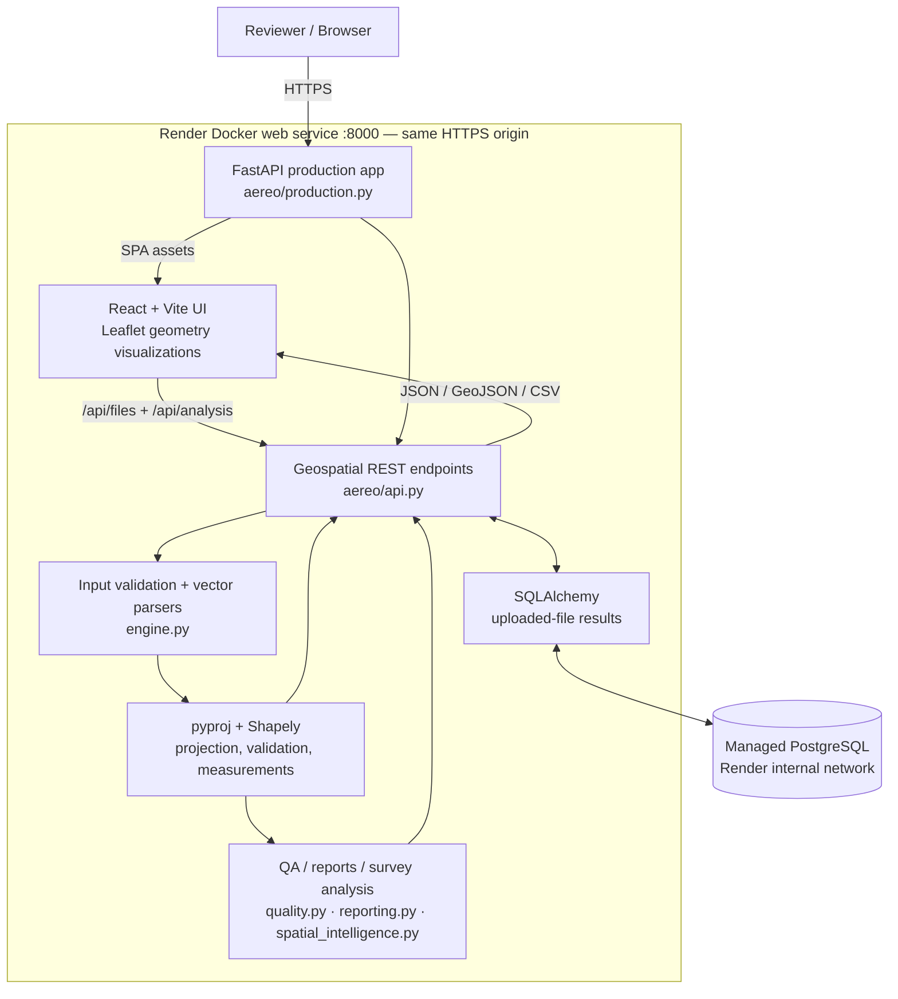
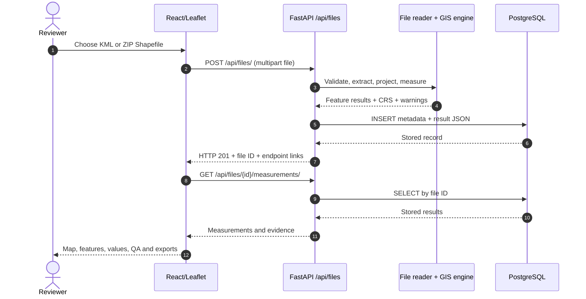
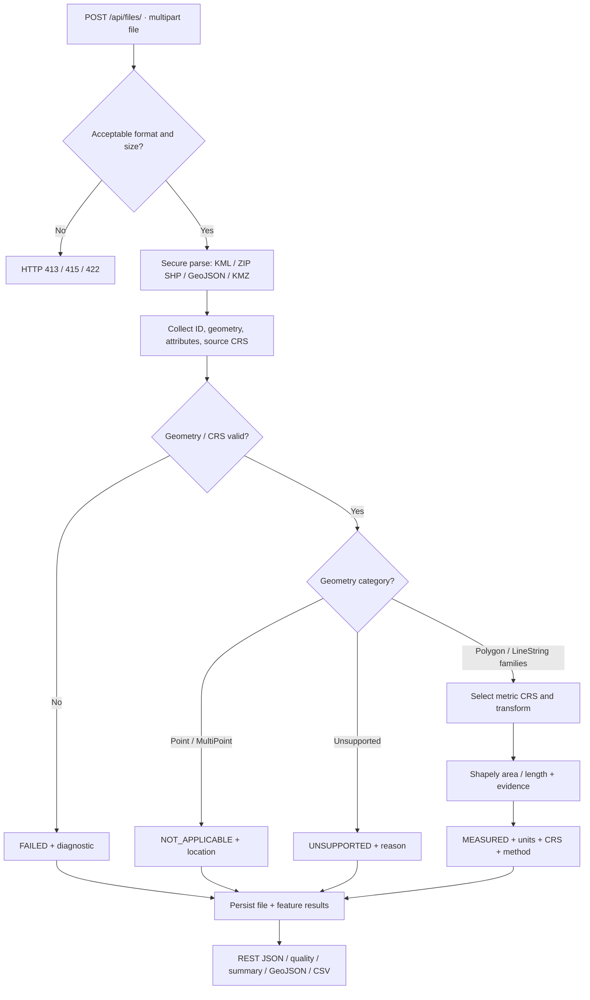
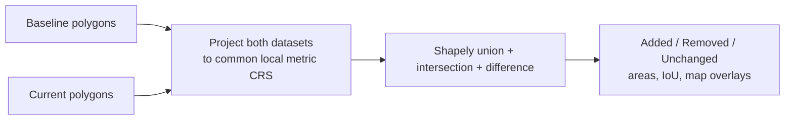
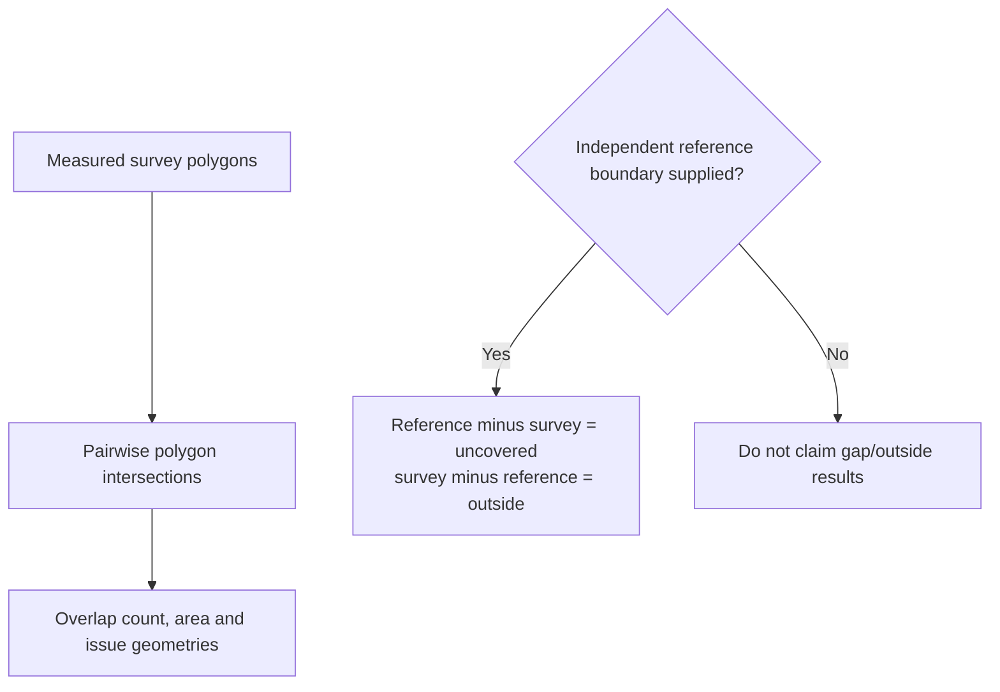
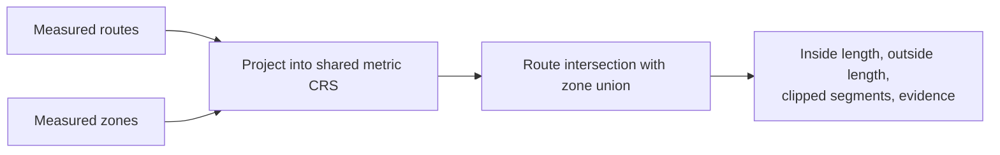

<!-- GEOINSIGHT_AEREO_RELEASE_README_V3 -->
# GeoInsight

### Geospatial File Measurement API & Spatial Intelligence Workspace

**Aereo Internship Assignment · FastAPI · React · Shapely · pyproj · PostgreSQL · Docker**

> **From geospatial input to trustworthy measurement:** upload survey files, inspect geometries, calculate metric area and length using an appropriate projected coordinate system, flag quality issues, and explore evidence on an interactive map.

[](https://geoinsight-aereo.onrender.com/geospatial)
[](https://geoinsight-aereo.onrender.com/docs)
[](https://github.com/dhanushgowdars/Spatial-Asset-Management-Platform/actions)

**Quick links:** [Launch application ↗](https://geoinsight-aereo.onrender.com/geospatial) · [Reviewer walkthrough ↗](https://geoinsight-aereo.onrender.com/geospatial/guide) · [Swagger/OpenAPI ↗](https://geoinsight-aereo.onrender.com/docs) · [Health check ↗](https://geoinsight-aereo.onrender.com/health) · [Sample inputs](aereo_samples/) · [Test cases](aereo_tests/)

> [!IMPORTANT]
> **Which project is this?** This README documents **GeoInsight**, the independently running Aereo file-measurement assessment. The repository also contains an earlier **Spatial Asset Management Platform** (asset CRUD, JWT/RBAC, PostGIS queries, history and audit APIs). Its complete original documentation is preserved separately in **[docs/SPATIAL_ASSET_MANAGEMENT_PLATFORM.md](docs/SPATIAL_ASSET_MANAGEMENT_PLATFORM.md)**. Those older endpoints are **not served by the public GeoInsight deployment**. The projects will be extracted into separate repositories after the assessment; their features and security models should not be confused.
>
> To keep GitHub open while visiting the live demo, use **Ctrl+click / middle-click** (Windows/Linux) or **Cmd+click** (macOS). GitHub Markdown cannot reliably force a new tab.

---

## Contents

1. [Project overview and problem statement](#1-project-overview-and-problem-statement)
2. [Aereo requirements: compliance](#2-aereo-requirements-compliance)
3. [Features and what to try](#3-features-and-what-to-try)
4. [System architecture](#4-system-architecture)
5. [File ingestion and measurement workflow](#5-file-ingestion-and-measurement-workflow)
6. [CRS selection, formulas and measurement evidence](#6-crs-selection-formulas-and-measurement-evidence)
7. [REST API contracts and examples](#7-rest-api-contracts-and-examples)
8. [Survey intelligence workflows](#8-survey-intelligence-workflows)
9. [Repository layout and technology stack](#9-repository-layout-and-technology-stack)
10. [Local setup and deployment](#10-local-setup-and-deployment)
11. [Testing and verified results](#11-testing-and-verified-results)
12. [Design decisions and trade-offs](#12-design-decisions-and-trade-offs)
13. [Scope, security and limitations](#13-scope-security-and-limitations)
14. [Learning outcomes and future scope](#14-learning-outcomes-and-future-scope)
15. [Maintainer and related project](#15-maintainer-and-related-project)

---

## 1. Project overview and problem statement

Survey data arrives as **KML**, **zipped ESRI Shapefiles** and related vector formats. Files may contain polygons, routes, points, multipart features, incorrect coordinates, missing CRS definitions or invalid geometry. If longitude/latitude values in degrees are treated as metres, calculated areas and distances are wrong; if invalid records are ignored without evidence, survey review becomes difficult.

**GeoInsight** implements a backend-first solution that:

- Accepts geospatial vector files via a documented REST API.
- Parses each feature's **ID, geometry type, geometry, source CRS and attributes**.
- Separates **geometry validity**, **measurement eligibility** and **file-level processing status**.
- Uses **pyproj** to transform geographic geometry into a suitable **metric projected CRS** before measuring with **Shapely**.
- Stores source-linked results, validation diagnostics, units, calculation method and provenance in a database.
- Serves the same results through **JSON, GeoJSON, CSV** and an interactive **React/Leaflet** interface.
- Extends the basic assignment with survey QA, change comparison, topology review and route–zone intersection.

**Intended users:** GIS developers, field-survey reviewers and evaluators checking vector-data correctness. **Primary outcome:** an auditable area or distance, not just a number without coordinates, units or a known measurement method.

### At a glance

| Area | Implemented capability |
| --- | --- |
| **Inputs** | KML, zipped Shapefile; bonus GeoJSON and KMZ |
| **Geometries** | Polygon, MultiPolygon, LineString, MultiLineString, Point, MultiPoint; unsupported/invalid handling |
| **Results** | Metric area (m²), line length (m), perimeter (m), geometry evidence, status and warnings |
| **Intelligence** | Data quality, survey comparison, parcel topology, route–zone intersections |
| **Interface** | Responsive multi-page React workspace with geometry maps and reviewer guide |
| **Exports** | Machine-readable JSON/GeoJSON and downloadable CSV/GeoJSON |
| **Deployment** | One-origin React + FastAPI Docker service on Render, managed PostgreSQL |
| **Testing** | Backend tests, frontend tests/lint/build, local API acceptance and live cloud checks |

---

## 2. Aereo requirements: compliance

The supplied **Geospatial File Measurement API** brief asks for a Python backend, KML/Shapefile uploads, extraction of feature evidence, projected-CRS measurements, three specific endpoints, and a documented public GitHub repository. The frontend and extra analysis workspaces are extensions, **not substitutes for the required backend API**.

| Mandatory item | Where it is implemented | Evidence |
| --- | --- | --- |
| **FastAPI or Django** | [`aereo/api.py`](aereo/api.py), FastAPI | `/docs`, endpoint tests |
| **`.kml` and zipped `.shp` upload** | `POST /api/files/`, [`engine.py`](app/services/geospatial/engine.py) | KML/Shapefile fixture tests |
| **Feature ID/index, type, geometry, CRS, properties** | `/measurements/` JSON and `/geojson/` | Source-linked result records |
| **Polygon area** | Projected geometry `.area` | Verified 10,000 m² square |
| **LineString length** | Projected geometry `.length` | Known-length fixtures |
| **Point handling** | `NOT_APPLICABLE` status with location retained | Mixed-geometry tests |
| **Handle invalid/unsupported geometry** | Per-feature `FAILED` / `UNSUPPORTED`, reason and QA diagnostics | Invalid-input tests |
| **CRS conversion before measuring** | [`_select_metric_crs`](app/services/geospatial/engine.py), `pyproj.Transformer` | Source CRS vs measurement CRS tested |
| **`POST /api/files/`** | Upload, process and persist | HTTP 201 in API tests |
| **`GET /api/files/{id}/`** | File metadata | Live retrieval test |
| **`GET /api/files/{id}/measurements/`** | Per-feature results | Live area/CRS test |
| **README setup, API examples, architecture, decisions, learning, future scope** | This README | Sections 4–14 |

---

## 3. Features and what to try

### Core workspace: file measurement

[**Open Measure ↗**](https://geoinsight-aereo.onrender.com/geospatial)

1. Select the bundled **KML mixed-geometries** sample or **Shapefile 100 m square**, or upload your own supported file (synthetic/non-confidential data only).
2. Inspect detected features, geometry categories, source CRS, attributes, measured results and status.
3. Choose a feature to inspect the geometry on the map. Compare **source CRS** with **measurement CRS** and read the method and warnings.
4. Download machine-readable results; use `/docs` to inspect the raw API equivalents.

### Additional analysis modules

| Workspace | What it calculates / displays | Live route |
| --- | --- | --- |
| **Survey quality** | Valid/invalid feature diagnostics, measurement eligibility, missing CRS, error codes, feature-level QA | [Open ↗](https://geoinsight-aereo.onrender.com/geospatial/quality) |
| **Compare surveys** | Added, removed, unchanged/overlap polygon regions; area metrics, IoU and result overlays | [Open ↗](https://geoinsight-aereo.onrender.com/geospatial/compare) |
| **Topology** | Overlapping parcel pairs; optional reference-boundary uncovered and outside regions | [Open ↗](https://geoinsight-aereo.onrender.com/geospatial/topology) |
| **Routes & zones** | Total route, inside-zone and outside-zone length; clipped line segments | [Open ↗](https://geoinsight-aereo.onrender.com/geospatial/routes) |
| **About & reviewer guide** | Supported formats, workflows, example scenarios, implementation explanations, Q&A | [Open ↗](https://geoinsight-aereo.onrender.com/geospatial/guide) |

> [!TIP]
> **Three-minute reviewer path:** Measure a KML or SHP → inspect its `EPSG:4326` source and projected metric results → open Survey Quality → run Compare with the bundled baseline/current fixtures → inspect Topology and Routes & Zones → visit Swagger for the three required APIs. Browser samples are uploaded to the real backend; displayed analysis figures are not hard-coded in React.

### Deterministic reference scenarios

| Synthetic example | Expected result | What it proves |
| --- | --- | --- |
| 100 m × 100 m polygon | **10,000 m² area**, **400 m perimeter** | Projected metric geometry |
| Two 100 m survey footprints shifted by 50 m | ~**5,000 m²** added, removed and unchanged/overlap | Polygon overlay accounting |
| Two partially overlapping parcels | One overlap of ~**5,000 m²** | Topology intersection |
| Reference boundary with shifted survey | **0 m²** uncovered and ~**5,000 m²** outside for the verified fixture | Explicit reference-based comparison |
| 140 m line passing through a zone | **40 m inside**, **100 m outside** | Route clipping / length conservation |
| Mixed valid polygon, Point and invalid feature | `MEASURED`, `NOT_APPLICABLE`, `FAILED` | Per-feature error handling |

These figures are for the supplied **synthetic test geometry**, not certified real-world land measurements.

---

## 4. System architecture

### 4.1 Deployed application — components and data flow



**What happens at runtime:** `aereo.production:create_production_app` serves compiled React assets and GeoInsight's FastAPI API from one service. React requests the same-host `/api/...` endpoints. SQLAlchemy persists uploaded metadata and computed result JSON in PostgreSQL. The `/health` endpoint queries the database, not just the web server.

**Important architectural boundary:** This container deliberately **does not start** the original asset-management `app.main:app`. That earlier application has its own JWT/RBAC APIs and PostGIS database model and requires independent deployment. GeoInsight uses **Shapely/pyproj** for spatial calculations and **plain PostgreSQL** for persistence—**not PostGIS** for its measurements.

### 4.2 Request sequence: upload → calculate → retrieve



### 4.3 Backend separation and responsibilities

| Component | Actual path | Responsibility |
| --- | --- | --- |
| HTTP / OpenAPI | [`aereo/api.py`](aereo/api.py) | Routes, request validation, DB sessions, responses and HTTP errors |
| Production host | [`aereo/production.py`](aereo/production.py) | React assets, deep-link handling, one-origin API |
| GIS parser/engine | [`app/services/geospatial/engine.py`](app/services/geospatial/engine.py) | KML, SHP ZIP, GeoJSON, KMZ, CRS, measurement and source evidence |
| Quality diagnostics | [`quality.py`](app/services/geospatial/quality.py) | Structured issues and QA rollups |
| Summaries / exports | [`reporting.py`](app/services/geospatial/reporting.py) | Dataset summaries, CSV, GeoJSON |
| Spatial intelligence | [`spatial_intelligence.py`](app/services/geospatial/spatial_intelligence.py) | Comparison, topology and route-zone overlays |
| Measurement UI | [`frontend/src/pages/Geospatial/`](frontend/src/pages/Geospatial/) | Upload/map/table/inspector |
| Analysis pages | [`frontend/src/pages/SpatialIntelligence/`](frontend/src/pages/SpatialIntelligence/) | Quality, compare, topology and routes |
| Guide | [`frontend/src/pages/GeoGuide/`](frontend/src/pages/GeoGuide/) | Reviewer guide and Q&A |
| Docker build | [`aereo/Dockerfile`](aereo/Dockerfile) | Node 22 frontend build + Python 3.11 API runtime |

---

## 5. File ingestion and measurement workflow



### Step-by-step processing details

1. **Validate the input.** Accept `.kml`, `.zip` (one Shapefile), `.geojson`, `.kmz`; reject unsupported file types, empty uploads and uploads above **10 MiB**. ZIP input is checked for traversal, symlinks, duplicate paths, suspicious compression and expanded-file limits. Parsing is bounded by feature and geometry limits.
2. **Read the source.** KML Placemarks are read with safe XML parsing; zipped Shapefiles require `.shp`, `.shx`, `.dbf` (optional `.prj` supplies its CRS); GeoJSON is interpreted as WGS84; KMZ contains KML. Feature ID/index and source properties remain available for review.
3. **Diagnose each feature.** Empty, malformed, invalid or coordinate-inconsistent geometries receive an explanatory status instead of inventing a measurement. A valid Point remains an inspectable record but has no area or length requirement.
4. **Prepare coordinates.** Transform into WGS84 for display (`geometry` and geographic bbox), select a **metric** CRS for measurement, and record both the original and measurement CRS.
5. **Measure eligible geometry.** Polygons/MultiPolygons: planar area in m² and boundary perimeter in m (including holes). Lines/MultiLines: planar length in m, line parts, segments, start/end evidence. Attach `measurement_method: projected_planar_geometry`.
6. **Persist one result.** Store the dataset metadata, file hash, status and feature result JSON. Return a unique ID for later requests. Dataset status can be `COMPLETED` or `COMPLETED_WITH_ERRORS` if at least one feature failed.
7. **Return inspectable outputs.** Get individual measurements, quality findings, a summary, map-ready GeoJSON and downloadable server-side exports. Additional analyses operate on uploaded dataset IDs.

### Meaning of the result statuses

| Status | Interpretation |
| --- | --- |
| `MEASURED` | Supported valid line/polygon measured successfully in a projected CRS |
| `NOT_APPLICABLE` | Valid Point/MultiPoint retained; area/length not required |
| `UNSUPPORTED` | Other geometry type is present but no defined metric measurement is provided |
| `FAILED` | Parsing, geometry, missing-CRS or transformation problem; inspect the `error` and QA issues |

> [!NOTE]
> A successful file upload does **not** imply every feature can be measured. Inspect `successful_measurements`, `failed_features`, the dataset status and each feature's `status` before using results.

---

## 6. CRS selection, formulas and measurement evidence

### Why we cannot measure in latitude/longitude

Coordinates such as `EPSG:4326` are expressed in **degrees**. Shapely's area and length are planar operations on coordinate values; running them directly on degrees would return degree-based values, not square metres or metres.

GeoInsight first converts coordinates using `pyproj.Transformer` (`always_xy=True`) and computes metrics only in a suitable **metre-based projection**.

### Projection strategy implemented

| Input / extent | Measurement strategy |
| --- | --- |
| Small/local WGS84 footprint within suitable UTM latitude bounds | Select a local UTM zone from the feature's representative location (`EPSG:326xx` north / `EPSG:327xx` south) |
| Large/polar **polygon** | Local Lambert azimuthal equal-area (`LAEA`), with a distortion warning |
| Large/polar **line** | Local azimuthal equidistant (`AEQD`), with a warning |
| Shapefile with no known `.prj` CRS | Do **not** guess a CRS; mark the affected feature `FAILED` with explanation |
| Point / MultiPoint | Preserve WGS84 display location; no area or length calculation |

For small Bengaluru-region fixtures, the resulting UTM coordinate system is **`EPSG:32643`**.

### Calculations

Once transformed to metre units, the engine uses:

- **Polygon area:** `measured_geometry.area` → `m2` (square metres).
- **Line length:** `measured_geometry.length` → `m` (metres).
- **Polygon perimeter:** `measured_geometry.boundary.length` → `m`, including interior-hole boundaries.
- **Centroid:** calculate in metric coordinates, then transform the centroid to WGS84 for display.
- **Bounds / start / end:** convert geometry evidence into WGS84 (`longitude, latitude`) for the UI and exports.

Example from the live verification:

| Evidence | Value |
| --- | --- |
| Test shape | Synthetic 100 m × 100 m polygon |
| Reported area | **10,000.0 m²** |
| Reported perimeter | **400.0 m** |
| Source CRS | `EPSG:4326` |
| Measurement CRS | `EPSG:32643` |
| Method | `projected_planar_geometry` |
| Feature status | `MEASURED` |

**Accuracy boundary:** this is deterministic **2D projected planar** analysis. Projection distortion, source CRS errors, survey precision and terrain elevation are not automatically corrected. It is not a certified cadastral or 3D terrain calculation.

---

## 7. REST API contracts and examples

**Base URL:** `https://geoinsight-aereo.onrender.com`

**Interactive reference:** [Swagger/OpenAPI ↗](https://geoinsight-aereo.onrender.com/docs)

### Required Aereo APIs

| Method | Endpoint | Request | Response |
| --- | --- | --- | --- |
| **POST** | **`/api/files/`** | `multipart/form-data`, field `file` | HTTP 201 with ID, filename, status, feature counts and next-resource URLs |
| **GET** | **`/api/files/{id}/`** | Stored 32-character file ID | File metadata, CRS, counts, hash, status |
| **GET** | **`/api/files/{id}/measurements/`** | Stored file ID | Feature-level ID, geometry, source CRS, projected measurement, method, status, errors and evidence |

### Additional APIs

| Method | Endpoint | Purpose |
| --- | --- | --- |
| GET | `/api/files/{id}/quality/` | Dataset and feature-level QA findings |
| GET | `/api/files/{id}/summary/` | Counts and aggregated measurement overview |
| GET | `/api/files/{id}/geojson/` | WGS84 FeatureCollection for map display |
| GET | `/api/files/{id}/export/?format=csv` | Download CSV; also supports `format=geojson` |
| POST | `/api/analysis/compare` | Compare stored baseline/current survey IDs |
| POST | `/api/analysis/topology` | Assess polygon topology, optional independent reference ID |
| POST | `/api/analysis/route-zones` | Overlay stored routes against stored zones |
| GET | `/health` | Queries database; returns `{"status":"healthy"}` when ready |
| GET | `/docs` | Interactive documentation and request-body schemas |

### Example A — Upload KML/Shapefile or the bundled GeoJSON sample

From the repository root in **PowerShell**:

```powershell
$base = "https://geoinsight-aereo.onrender.com"
$sample = (Resolve-Path ".\frontend\public\samples\c4a_baseline.geojson").Path

$uploaded = curl.exe -fsS -F "file=@$sample" "$base/api/files/" | ConvertFrom-Json
$fileId = $uploaded.id
$uploaded | Format-List id, filename, crs, status, feature_count, successful_measurements
```

To exercise a **mandatory input format**, substitute:

```powershell
$sample = (Resolve-Path ".\aereo_samples\mixed.kml").Path
# or
$sample = (Resolve-Path ".\aereo_samples\plot-utm43n.zip").Path
```

The backend returns a new random ID for every upload. A successful upload resembles this **abbreviated response** (values shown are illustrative):

```json
{
  "id": "<32-character-file-id>",
  "filename": "c4a_baseline.geojson",
  "feature_count": 1,
  "crs": "EPSG:4326",
  "status": "COMPLETED",
  "successful_measurements": 1,
  "failed_features": 0,
  "file_url": "/api/files/<id>/",
  "measurements_url": "/api/files/<id>/measurements/"
}
```

### Example B — Retrieve metadata and measurements

```powershell
# Run after the upload above, in the same PowerShell session
$info = Invoke-RestMethod "$base/api/files/$fileId/"
$data = Invoke-RestMethod "$base/api/files/$fileId/measurements/"

$info | Format-List
$data.measurements | Select-Object id, geometry_type, crs, measurement_crs, status
$data.measurements[0].measurement | Format-List
```

An abbreviated feature measurement looks like:

```json
{
  "id": "baseline-100m-square",
  "geometry_type": "Polygon",
  "crs": "EPSG:4326",
  "measurement_crs": "EPSG:32643",
  "measurement_method": "projected_planar_geometry",
  "status": "MEASURED",
  "measurement": {
    "type": "area",
    "value": 10000.0,
    "unit": "m2"
  },
  "evidence": {
    "perimeter_m": 400.0
  }
}
```

The actual API result additionally includes `index`, `geometry`, `properties`, `warnings`, `issues` and other evidence; use Swagger for the live schema.

### Example C — Quality, GeoJSON and exports

```powershell
Invoke-RestMethod "$base/api/files/$fileId/quality/"
Invoke-RestMethod "$base/api/files/$fileId/summary/"
Invoke-RestMethod "$base/api/files/$fileId/geojson/"

curl.exe -fLsS "$base/api/files/$fileId/export/?format=csv" -o "geoinsight-results.csv"
curl.exe -fLsS "$base/api/files/$fileId/export/?format=geojson" -o "geoinsight-results.geojson"
```

### Example D — Comparison, topology and route–zone operations

Upload the applicable baseline/current, parcel/reference or route/zone fixtures first and retain their IDs.

```powershell
$compareBody = @{
  baseline_file_id = "<baseline-file-id>"
  current_file_id  = "<current-file-id>"
} | ConvertTo-Json
Invoke-RestMethod -Method Post "$base/api/analysis/compare" `
  -ContentType "application/json" -Body $compareBody

$topologyBody = @{
  file_id = "<parcel-file-id>"
  reference_file_id = "<optional-reference-id>"
} | ConvertTo-Json
Invoke-RestMethod -Method Post "$base/api/analysis/topology" `
  -ContentType "application/json" -Body $topologyBody

$routeBody = @{
  route_file_id = "<route-file-id>"
  zone_file_id  = "<zone-file-id>"
} | ConvertTo-Json
Invoke-RestMethod -Method Post "$base/api/analysis/route-zones" `
  -ContentType "application/json" -Body $routeBody
```

The `<...>` identifiers above are **placeholders**. If topology is to be assessed **without** a reference boundary, omit `reference_file_id` from the request.

### Error handling conventions

| HTTP code | Example meaning |
| --- | --- |
| `201` | File accepted, processed and persisted |
| `404` | Unknown file ID |
| `413` | Empty or oversized uploaded file |
| `415` | Unsupported upload extension |
| `422` | Invalid KML, unsafe/invalid archive, invalid analysis request, unsupported export format |
| `503` | Database unavailable or upload persistence failed |

Per-feature issues can be reported **inside an accepted file result** instead of as an HTTP error; inspect the statuses.

---

## 8. Survey intelligence workflows

The extra modules are built on the same persisted dataset IDs as the required measurement API. They use deterministic vector geometry operations, with results rendered in React/Leaflet.

### 8.1 Survey change detection



- **Added:** current footprint minus baseline footprint.
- **Removed:** baseline footprint minus current footprint.
- **Unchanged/overlap:** intersection of both footprints.
- **IoU:** intersection area divided by union area where defined.
- Avoids double counting overlapped polygons within one survey by using unioned footprints.
- Synthetic shifted-square reference: ~5,000 m² for each of added, removed and overlap, and ~33.33% IoU.

### 8.2 Parcel topology with optional site reference



- Identifies overlapping parcel pairs and the affected geometry.
- **Uncovered/gap** and **outside-reference** metrics are defined only when a separate reference polygon is supplied; absence of a reference must not be mistaken for zero gap.
- Distinguishes source parcels from derived intersection and difference overlays; reports measurement CRS and method.

### 8.3 Route/zone intersection



- Handles relevant LineString/MultiLineString inputs and polygon zones.
- Computes inside and outside route lengths without double-counting overlapping zones.
- Verified reference: 140 m route = 40 m inside + 100 m outside.
- Large/complex analyses are bounded; this is a review-grade deterministic workflow, not a large-scale geospatial processing cluster.

---

## 9. Repository layout and technology stack

### Source tree (relevant GeoInsight paths)

```text
Spatial-Asset-Management-Platform/
├── README.md                         ← THIS GeoInsight assessment README
├── aereo/
│   ├── api.py                        ← required REST API + persisted analyses
│   ├── production.py                 ← serves React and FastAPI together
│   └── Dockerfile                    ← production multi-stage image
├── app/services/geospatial/
│   ├── engine.py                     ← secure input parsing + metric measurement
│   ├── quality.py                    ← validation/QA issues
│   ├── reporting.py                  ← summaries, CSV and GeoJSON exports
│   └── spatial_intelligence.py       ← comparison, topology, route overlays
├── frontend/
│   ├── src/pages/Geospatial/         ← measure/map/inspector
│   ├── src/pages/SpatialIntelligence/ ← quality, compare, topology, routes
│   ├── src/pages/GeoGuide/          ← explanations and reviewer walkthrough
│   └── public/samples/              ← browser-supplied example datasets
├── aereo_tests/                     ← GeoInsight API and GIS test suite
├── aereo_samples/                   ← synthetic KML, SHP, KMZ, GeoJSON fixtures
├── docs/
│   ├── AEREO_C4B_INTELLIGENCE_WORKSPACE.md
│   ├── AEREO_DOCKER_RELEASE.md
│   ├── GEOINSIGHT_TECHNICAL_GUIDE.md
│   └── SPATIAL_ASSET_MANAGEMENT_PLATFORM.md ← separate older project docs
├── requirements.txt
├── aereo-requirements.txt
└── .github/workflows/aereo-ci.yml   ← backend + frontend CI
```

This is currently a **shared historical repository**, not yet a clean extracted GeoInsight repository. Unrelated older `app` modules and React pages remain available but are not served as working asset-management endpoints by the GeoInsight Render service.

### Stack

| Layer | Technology | Purpose |
| --- | --- | --- |
| Backend | Python 3.11, FastAPI, Pydantic | REST API, validation and OpenAPI |
| Spatial algorithms | Shapely, pyproj, pyshp, safe XML and ZIP readers | Geometry extraction, projection, metric computation |
| ORM / persistence | SQLAlchemy, PostgreSQL (public), SQLite (local option) | Persist result JSON and metadata |
| Frontend | React 19, Vite, React Router | Multi-page reviewer workspace |
| GIS map | Leaflet / React Leaflet | Geometry visualization, inspection, overlays |
| Build/runtime | Node 22 (build), Docker, Uvicorn | Single-origin production release |
| Validation | pytest, Node tests, ESLint, Vite build, GitHub Actions | Regression and build checks |
| Hosting | Render web service + managed database | Public HTTPS deployment |

---

## 10. Local setup and deployment

### Prerequisites

- **Docker Desktop** with Linux containers for the simplest end-to-end reproduction.
- Or **Python 3.11**, Node/npm and Git for running components directly.
- A PostgreSQL/PostGIS server is **not necessary** for the local GeoInsight assessment; the Docker preview uses a named SQLite volume by default.

### Option A — Full application with Docker (recommended)

```powershell
git clone https://github.com/dhanushgowdars/Spatial-Asset-Management-Platform.git
cd Spatial-Asset-Management-Platform

docker build -f aereo/Dockerfile -t geoinsight:release .
docker run --rm --name geoinsight-preview -p 18140:8000 `
  -v geoinsight-results:/data geoinsight:release
```

Then open:

- Frontend: `http://localhost:18140/geospatial`
- API reference: `http://localhost:18140/docs`
- Health check: `http://localhost:18140/health`

**Persistence test:** upload a file, note its ID, stop the container, rerun the same command and retrieve `/api/files/{id}/`. The Docker named volume remains. Do **not** remove `geoinsight-results` unless you intentionally want to discard those preview records. If `geoinsight-preview` is already running, stop it before creating another instance with the same name.

### Option B — Python REST API only

```powershell
python -m venv .venv
.\.venv\Scripts\Activate.ps1
python -m pip install -r requirements.txt -r aereo-requirements.txt
uvicorn aereo.api:app --host 127.0.0.1 --port 18130
```

- Open `http://127.0.0.1:18130/docs`.
- The default standalone storage is SQLite at `.aereo/measurements.sqlite3`.
- To test the frontend separately, install packages with `npm --prefix frontend ci` and run `npm --prefix frontend run dev` with an appropriate API proxy/URL configuration; the Docker route above is the tested single-origin workflow.

### Production hosting details

| Setting | Public deployment |
| --- | --- |
| Application URL | `https://geoinsight-aereo.onrender.com/geospatial` |
| Service runtime | Docker, `aereo/Dockerfile`, repository-root build context `.` |
| Start command | `uvicorn aereo.production:create_production_app --factory --host 0.0.0.0 --port 8000 --proxy-headers` |
| Health endpoint | `/health` |
| Database | Render managed PostgreSQL via secret `AEREO_DATABASE_URL` |
| Database environment | Internal PostgreSQL URL, never committed to Git |
| Public / local distinction | Hosted PostgreSQL; local Docker SQLite named volume |

> [!WARNING]
> The public demo is not a hardened multi-tenant service. Do not upload confidential survey data. The database's free-tier retention window and Render cold starts mean availability and longevity are not guaranteed.

---

## 11. Testing and verified results

### Evidence summary — 11 October 2026

| Verification | Observed result | Test coverage / meaning |
| --- | --- | --- |
| **Backend pytest** | **81 / 81 passed** | GIS parsing, validation, API routes, evidence, analysis and compatibility |
| **Frontend component/contract tests** | **14 / 14 passed** in reported local run | Presentation and analysis contracts |
| **HTTP local acceptance** | **37 / 37 passed** | Real local API requests and reference fixtures |
| **Frontend lint and production build** | Passed | ESLint + Vite build |
| **Production npm audit** | **0 vulnerabilities** in the reported `--omit=dev --audit-level=high` run | Production dependency advisory check at that time |
| **GitHub CI** | Passed for verified `584ebe8` release | FastAPI tests, frontend lint/build and contract test |
| **Public Render routes** | **7 / 7 HTTP 200** | `/geospatial`, `/quality`, `/compare`, `/topology`, `/routes`, `/guide`, `/docs` |
| **Public `/health`** | `{"status":"healthy"}` | Database query succeeds |
| **Public upload/export** | `COMPLETED`; **10,000 m²**, **400 m**, CRS `EPSG:32643` | GeoJSON upload, measurements, CSV + GeoJSON exports |
| **Restart persistence** | Same 32-character file ID retrievable after Render restart | Cloud database storage survived web-service restart |

These numbers are observed verification evidence for our implementation and synthetic fixtures; they do **not** certify measurement accuracy for third-party surveys, production penetration-testing or stress-load reliability.

### Reproduce the automated checks

```powershell
# Assessment backend
python -m pytest aereo_tests -q

# Frontend contracts / regression tests
node --test frontend/src/pages/SpatialIntelligence/demoContracts.test.mjs frontend/src/pages/SpatialIntelligence/derivedProvenance.test.mjs frontend/src/pages/SpatialIntelligence/presentation.test.mjs

# Frontend quality and production build
npm --prefix frontend ci
npm --prefix frontend run lint
npm --prefix frontend run build
npm --prefix frontend audit --omit=dev --audit-level=high
```

**Caution:** The separate legacy project's [`tests/conftest.py`](tests/conftest.py) drops and recreates tables in its configured **test database**. Do **not** run an indiscriminate full `pytest` suite against an unverified database URL. GeoInsight's tests live in `aereo_tests/` and use isolated fixtures.

### What the test suite covers

- Parsing and extracting real file contents from KML, zipped Shapefile, GeoJSON and KMZ test inputs.
- Unknown/missing CRS, invalid coordinates/geometries, zip traversal and malformed archives.
- Projected polygon area, hole/perimeter handling, line and multipart metrics, centroid and evidence.
- Point `NOT_APPLICABLE` and failed-feature partial report semantics.
- Quality diagnostics, summaries, CSV sanitization and GeoJSON property preservation.
- Comparing overlapping/disjoint footprints, survey topology/reference areas and clipped route-zone lengths.
- API contracts, metadata persistence, invalid analysis IDs and production deep-link hosting.

**Fixtures:** [`aereo_samples/`](aereo_samples/), [`frontend/public/samples/`](frontend/public/samples/), [`aereo_tests/`](aereo_tests/).

---

## 12. Design decisions and trade-offs

| Decision | Why | Alternative / trade-off |
| --- | --- | --- |
| **Standalone FastAPI assessment module** | Keeps the three required endpoints explicit and shields the legacy asset backend from changes | Unifying two backends now would add authentication, migration and regression complexity |
| **Shapely + pyproj for geometry** | Deterministic Python processing with visible CRS choice and method | PostGIS could handle spatial SQL at larger scale, but isn't needed for file measurements |
| **WGS84 for display, projected CRS for calculation** | Correct map interoperability without measuring in degrees | Projection distortion still matters for large extent or unsuitable input metadata |
| **Per-feature statuses and QA** | Invalid features don't silently contaminate valid outputs | Strict whole-file rejection loses partially recoverable data |
| **Bounded untrusted-input ingestion** | Controls archive/geometry abuse and avoids unbounded work | Not sufficient alone for public multiuser abuse protection |
| **Store parsed feature results** | Reproducible result retrieval and analysis of stored IDs | Raw-file archival and reprocessing/versioned provenance can be future work |
| **SQLAlchemy + PostgreSQL in cloud** | Data survives application container restart | Local SQLite is simpler but not suitable on Render's ephemeral free web storage |
| **Single-origin React + API** | A reviewer opens one live URL and avoids cross-domain configuration | Current service does not expose the unrelated original asset API |
| **Evidence-linked exports** | Auditable results with units, CRS, geometry and IDs | Not a substitute for independent ground-truth field validation |

---

## 13. Scope, security and limitations

### Included in this assessment

- Deterministic **2D vector geometry** measurements with projected CRS reporting.
- KML and zipped Shapefile minimum formats plus GeoJSON and KMZ.
- Dataset metadata, per-feature status/errors, quality diagnostics and exports.
- Polygon change analysis, overlap/topology and route intersections on bounded datasets.
- Public interactive reviewer application and Swagger API documentation.

### Not included / not claimed

- **No application-level authentication, authorization or rate limiting** on the GeoInsight public API. Records are retrievable by their file IDs; do **not** upload confidential or private surveys. The legacy app's JWT/RBAC does **not** protect this service.
- No certified cadastral/survey accuracy, geodesic or elevation-aware 3D terrain lengths, raster processing, photogrammetry, point-cloud reconstruction or independent real-world land-boundary validation.
- No unbounded bulk-file throughput; limits include **10 MiB input**, up to **5,000 features**, bounded vertex/ZIP-expansion allowances, and stricter limits for advanced analyses.
- No guaranteed high availability: Render free hosting may spin down when idle; free PostgreSQL has a **30-day expiry** and lacks production backup guarantees.
- No claim that the older asset-management backend is deployed on the GeoInsight URL. Its React map page is unfinished and its PostGIS service requires separate configuration.

### Typical failure review

| Symptom | What to inspect |
| --- | --- |
| `FAILED` / invalid polygon | Per-feature `error` and `/quality/`; invalid rings or coordinate transformation |
| Missing Shapefile CRS | Ensure accompanying `.prj` is valid; do not invent EPSG for unknown input |
| Wrong unit expectation | Compare `crs`, `measurement_crs`, `unit` and `measurement_method` |
| HTTP 413 / 415 / 422 | File size, extension, archive members, JSON/KML parse and shape limits |
| Delay opening public page | Render free cold start; retry after server wakes |
| HTTP 503 | Database availability; check health and service logs |
| Analysis rejects survey/route | Confirm upload ID, geometry family, valid measurement and analysis size/extent limits |

---

## 14. Learning outcomes and future scope

### Engineering lessons demonstrated

1. **CRS correctness precedes geometry mathematics.** Metric values require explicit transformation from geographic degrees, along with disclosure of the chosen CRS and its limits.
2. **Validity differs from eligibility.** A Point can be completely valid but have no applicable area/length; an invalid polygon must not receive a plausible invented value.
3. **Untrusted geospatial uploads are a security surface.** Safe XML/ZIP processing, size and expansion limits, and controlled feature counts are as important as geometry calculations.
4. **Results need evidence.** Feature IDs, original attributes, source geometry, method, CRS, warnings and exported records make review reproducible.
5. **Backend tests are necessary but not sufficient.** Known-size fixtures, independent reference comparisons, browser checks and a real cloud restart test verify different failure modes.
6. **Scope boundaries matter.** GeoInsight remains separate from the original authenticated asset-management backend, preventing unrelated deployment claims and regression risk.

### Possible next iterations (not claimed as implemented)

| Priority | Enhancement | Why it matters |
| --- | --- | --- |
| High | Accounts, authorization, rate limiting, retention/deletion controls | Safe multi-user access and protection of private surveys |
| High | Managed durable database backups and longer-term hosting | Stable public service beyond free-tier expiration |
| Medium | Versioned survey projects and saved analysis histories | Reproducible collaboration and comparison over time |
| Medium | Background file processing and job queue | Larger inputs without synchronous-request timeouts |
| Medium | Independent third-party GIS datasets and benchmarks | Better confidence beyond synthetic unit tests |
| Later | Large-area geodesic/elevation-aware calculations and PostGIS-based indexing | Extending beyond small-area 2D planar analyses |
| Later | Interactive editing, richer report sharing and permissioned links | Operational GIS workflows |

---

## 15. Maintainer and related project

Developed by **Dhanush R S** as an Aereo internship geospatial file-measurement assessment.

**The original Spatial Asset Management Platform is preserved—not hidden or deleted.** It contains a separate FastAPI/JWT/PostGIS asset-management backend, analytics, audit logging, location history and a partially completed React frontend. Its full architecture, endpoints, database design, installation instructions and history are available here:

**[Read the complete Spatial Asset Management Platform documentation →](docs/SPATIAL_ASSET_MANAGEMENT_PLATFORM.md)**

That older project's features are not claimed to be running on this GeoInsight deployment. The intended next step **after assessment submission** is to extract both into separately maintained repositories, complete the earlier frontend, deploy it, and link them from a unified geospatial portfolio.

---

**[Launch GeoInsight ↗](https://geoinsight-aereo.onrender.com/geospatial) · [Reviewer guide ↗](https://geoinsight-aereo.onrender.com/geospatial/guide) · [Swagger ↗](https://geoinsight-aereo.onrender.com/docs) · [Test inputs](aereo_samples/)**
