<!-- GEOINSIGHT_AEREO_SUBMISSION_README_V4: verified application screenshots and documentation -->
<div align="center">

# GeoInsight

### Geospatial File Measurement & Spatial Intelligence

**Aereo internship assignment · A working GIS API with an interactive reviewer workspace**

Upload geospatial files. Measure in the right coordinate system. Inspect *why* a result is valid. Compare survey boundaries, find overlaps, and analyse routes against zones.

[](https://geoinsight-aereo.onrender.com/geospatial)
[](https://geoinsight-aereo.onrender.com/docs)
[](https://github.com/dhanushgowdars/Spatial-Asset-Management-Platform/actions/workflows/aereo-ci.yml)

### [🚀 Open the live GeoInsight workspace →](https://geoinsight-aereo.onrender.com/geospatial)

<sub>Public interactive demo · No account required · Render free-tier cold start may take time</sub>

</div>

---

## Explore the live product

| Workspace | What a reviewer can do | Open |
| :--- | :--- | :--- |
| **01 — Measure** | Upload KML/Shapefile, inspect each geometry, CRS, area/length, map, and downloadable results | **[Launch measurement →](https://geoinsight-aereo.onrender.com/geospatial)** |
| **02 — Quality** | Review invalid geometries, unmeasurable Points, warnings and source evidence | [Open quality →](https://geoinsight-aereo.onrender.com/geospatial/quality) |
| **03 — Compare** | Overlay baseline and current polygon footprints; see added, removed and shared regions | [Compare surveys →](https://geoinsight-aereo.onrender.com/geospatial/compare) |
| **04 — Topology** | Find overlapping parcels and, with a reference boundary, uncovered/outside regions | [Inspect topology →](https://geoinsight-aereo.onrender.com/geospatial/topology) |
| **05 — Routes & zones** | Determine route length inside and outside survey/restricted polygons | [Analyse routes →](https://geoinsight-aereo.onrender.com/geospatial/routes) |
| **Guide** | Follow a walkthrough, learn the assumptions, and explore example scenarios | [Reviewer guide →](https://geoinsight-aereo.onrender.com/geospatial/guide) |

> [!TIP]
> **Start here (3 minutes):** **[Open GeoInsight Measure](https://geoinsight-aereo.onrender.com/geospatial)** → upload **your own KML, zipped ESRI Shapefile, GeoJSON or KMZ** → inspect the returned features, area/length (where applicable), source and measurement CRS, map, and downloadable results. Explore the other workspaces using your own compatible datasets, or test the three required endpoints in **[Swagger](https://geoinsight-aereo.onrender.com/docs)**. No provided example file is required. **Use public or synthetic data only**: this assessment demo does not have per-user access controls.

### A real measurement, not a mockup

[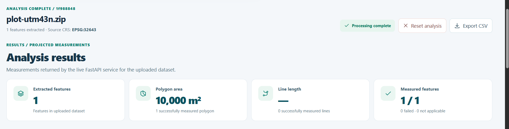](docs/images/geoinsight/01-measurement-results.png)

*Actual frontend capture from a synthetic 100 m × 100 m verification dataset · 1 successfully measured polygon · **10,000 m²** · EPSG:32643 · 0 failures. **[Upload your own survey file →](https://geoinsight-aereo.onrender.com/geospatial)**. Your results depend on your input.*

<details>
<summary><strong>Browse this README</strong></summary>

- [Real results: product showcase](#live-results--product-showcase)
- [Problem and solution](#the-problem-and-the-solution)
- [System architecture](#system-architecture)
- [Measurement pipeline and CRS](#how-geospatial-measurements-work)
- [Advanced spatial analyses](#spatial-intelligence-beyond-the-assignment)
- [Required API endpoints and examples](#api-reference--the-required-contract-first)
- [Technology and source layout](#technology-and-repository-layout)
- [Local setup and deployment](#run-locally)
- [Verified testing](#testing-and-reproducibility)
- [Design choices and limitations](#decisions-safeguards-and-limitations)

</details>

### What has been verified

| **81 / 81** | **37 / 37** | **14 / 14** | **Live deployment** |
| :---: | :---: | :---: | :---: |
| Aereo backend tests passed | Local HTTP acceptance checks passed | Reported frontend logic/presentation tests passed | Public upload, export and post-restart retrieval verified |

The counts above are from the reported October 2026 verification runs and synthetic reference datasets. See [testing and reproducibility](#testing-and-reproducibility) for the distinction between tested evidence and real-world survey certification.

---

## Live results — product showcase

These are **screenshots of the running React application** captured with known-size synthetic verification inputs. The backend generated every displayed value and map layer through real requests; these are not design mockups. The screenshots show **test evidence, not required input files**. Reviewers can use their own supported datasets in each workspace. **Select an image to open the full-resolution capture.**

### 1. Inspect geometry and measurement provenance

[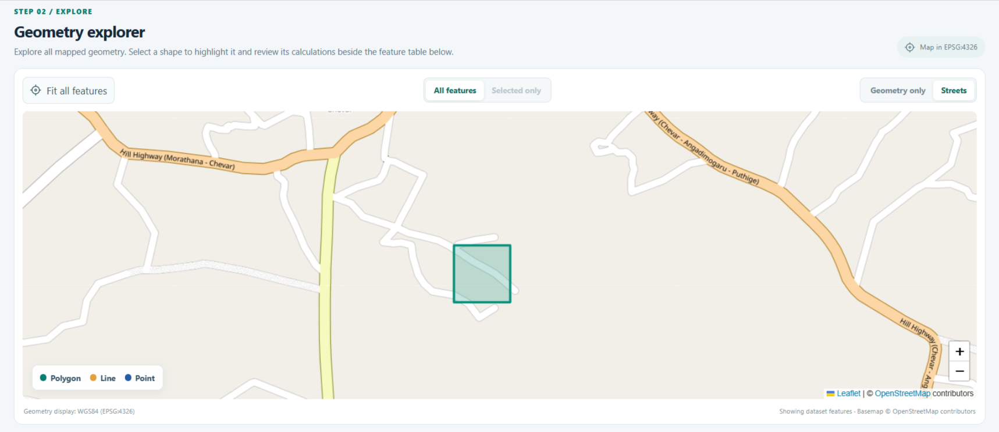](docs/images/geoinsight/02-geometry-explorer.png)

[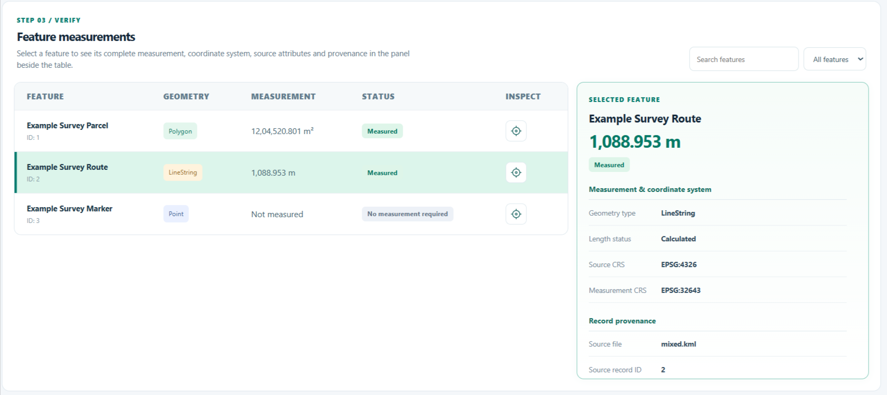](docs/images/geoinsight/03-feature-inspection.png)

The **map uses WGS84 for visualization**, while the feature inspector exposes the **projected measurement CRS, source record, geometry type, status and measured value**. A reviewer can select shapes or records and verify the calculation context.

### 2. Compare two surveys — quantify what changed

[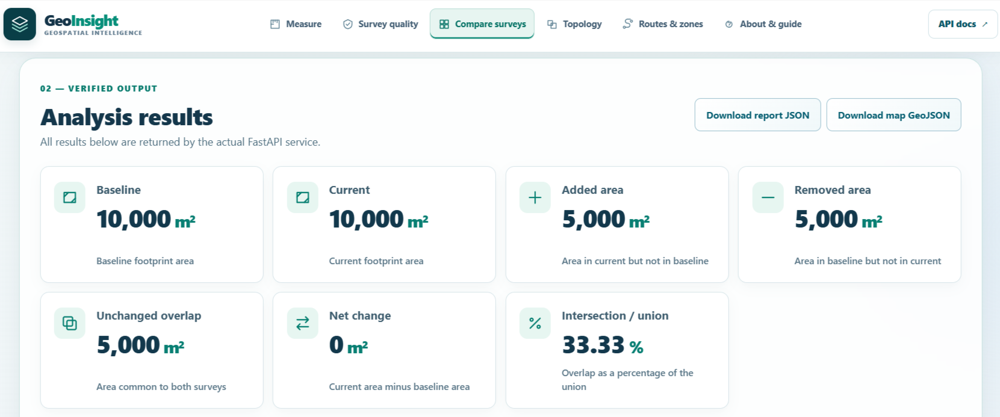](docs/images/geoinsight/04-survey-comparison-results.png)

[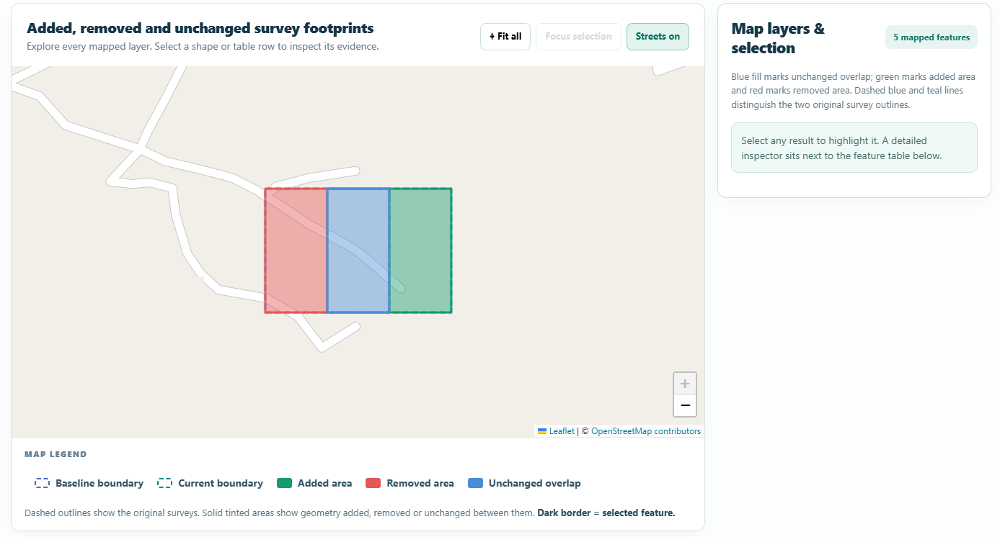](docs/images/geoinsight/05-survey-comparison-map.png)

This known-size verification scenario returns **5,000 m² added**, **5,000 m² removed**, and **5,000 m² unchanged**. Red, blue and green shapes are calculated difference and intersection geometries, not just colored numbers. **[Compare your own surveys →](https://geoinsight-aereo.onrender.com/geospatial/compare)**

<details>
<summary><strong>Inspect derived-overlay provenance (actual UI capture)</strong></summary>

[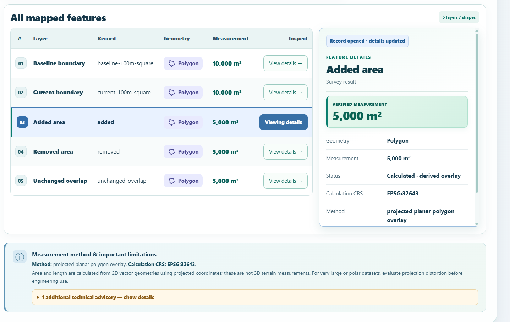](docs/images/geoinsight/06-survey-overlay-provenance.png)

A derived result is explicitly marked as calculated overlay geometry and retains its CRS/method instead of being presented as an original survey record.

</details>

### 3. Measure a route crossing a zone

[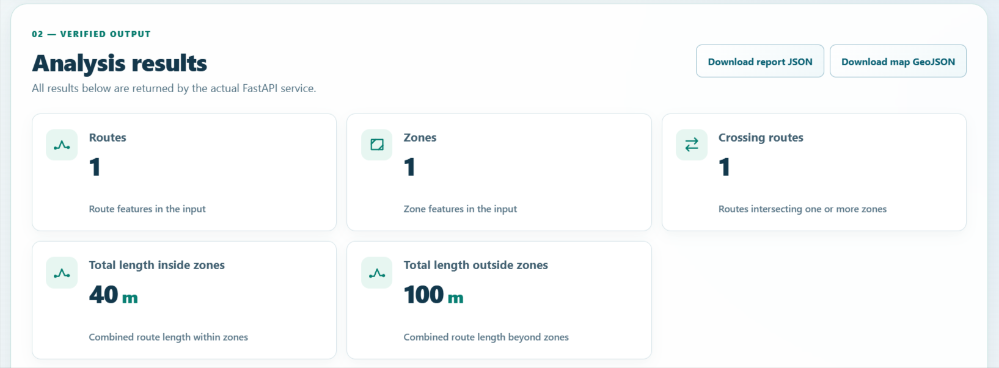](docs/images/geoinsight/07-route-zone-results.png)

[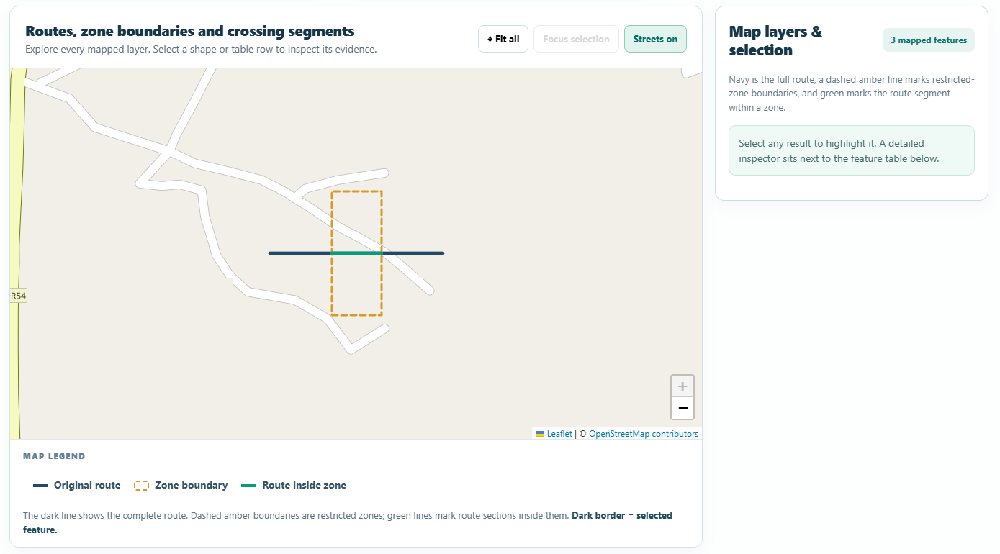](docs/images/geoinsight/08-route-zone-map.png)

In this verified scenario, a **140 m route** crosses a polygonal zone: **40 m inside** and **100 m outside**. The actual intersection geometry is calculated in a shared projected CRS and displayed as a separate map layer. **[Analyse your own routes and zones →](https://geoinsight-aereo.onrender.com/geospatial/routes)**

*Data note: these screenshots use synthetic reference geometry. They demonstrate working GIS processing but are not independent field-survey certification.*

---

## The problem and the solution

Geospatial data is not automatically measurable just because a map can display it. Survey files can contain geographic latitude/longitude coordinates (in **degrees**), unknown coordinate reference systems, malformed geometries, multipart features or conflicting parcel boundaries. Directly calculating planar distance or area on degree coordinates produces misleading units. Ignoring invalid records can make an apparently clean report difficult to defend.

**GeoInsight turns those files into inspectable, traceable measurements.** It reads the source geometry and attributes, validates each feature, chooses an appropriate *projected metric CRS*, calculates geometry measurements, preserves errors and provenance, and exposes the result through both an API and a map-based web interface.

**Primary assessment deliverable:** a FastAPI **Geospatial File Measurement API** handling KML and zipped ESRI Shapefiles with three required endpoints. The React interface, additional formats, QA, comparison, topology and route analysis are **implemented extensions**, not replacements for the requested API.

### At a glance

| Capability | Implementation |
| --- | --- |
| Supported uploads | **KML**, **zipped Shapefile** (required); GeoJSON and KMZ (additional) |
| Feature records | ID/index, geometry, type, properties, source CRS, status, warnings and evidence |
| Measurements | Polygon/MultiPolygon **area (m²)** and **perimeter (m)**; LineString/MultiLineString **length (m)** |
| Point behaviour | Preserve location and metadata; explicitly return **`NOT_APPLICABLE`** for area/length |
| CRS handling | **pyproj** converts coordinates to a suitable metric projection; **Shapely** calculates planar metrics |
| Data outputs | REST JSON, map-ready GeoJSON, CSV and GeoJSON downloads |
| Deployment | **React + FastAPI on one origin**, Docker on Render, PostgreSQL for persistent results |

### Aereo assessment requirements — traceable implementation

| Requirement | Where to verify |
| --- | --- |
| FastAPI backend; KML and zipped Shapefile upload | [`aereo/api.py`](aereo/api.py) · [`app/services/geospatial/engine.py`](app/services/geospatial/engine.py) |
| Feature ID/index, geometry type, geometry, CRS and attributes | [`GET /api/files/{id}/measurements/`](https://geoinsight-aereo.onrender.com/docs) · inspector screenshots above |
| Polygon area in m²; line length in m; Points retained without a fabricated metric | [Processing engine](app/services/geospatial/engine.py) · [measured examples](#how-geospatial-measurements-work) |
| Unsupported and invalid geometry handled safely | [Per-feature statuses](#geometry-decision-table) · [quality workspaces](https://geoinsight-aereo.onrender.com/geospatial/quality) |
| Transform geographic coordinates before measurement | [CRS explanation](#why-crs-selection-matters) · [`pyproj` processing](app/services/geospatial/engine.py) |
| Three required upload and retrieval endpoints | [API reference and sample requests](#api-reference--the-required-contract-first) |
| Public repository, setup, architecture, flow, choices, learning and next steps | This README · [isolated tests](aereo_tests/) · [supporting technical guide](docs/GEOINSIGHT_TECHNICAL_GUIDE.md) |

---

## System architecture

This is the **deployed GeoInsight architecture**, not a diagram of the older asset-management backend.

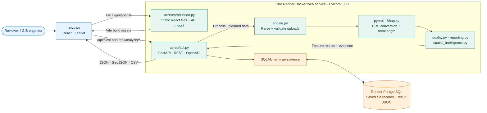

**How the pieces fit:** The multi-stage [`aereo/Dockerfile`](aereo/Dockerfile) builds the Vite frontend and Python backend into one image. [`aereo/production.py`](aereo/production.py) serves the compiled React application and the assessment API on the same HTTPS origin. The browser executes the React app and calls actual `/api/...` endpoints on the same origin. [`aereo/api.py`](aereo/api.py) handles requests, database sessions and result retrieval; the GIS calculations live in independent Python service modules. SQLAlchemy persists results in Render PostgreSQL so records can survive a web-service restart.

**Key distinction:** GeoInsight measures vector geometry in **Python (Shapely + pyproj)**, not via PostGIS. The original Spatial Asset Management Platform's JWT/RBAC and PostGIS API are **not running** at the GeoInsight URL; see [repository scope](#repository-scope-and-project-separation).

### Upload-to-result sequence

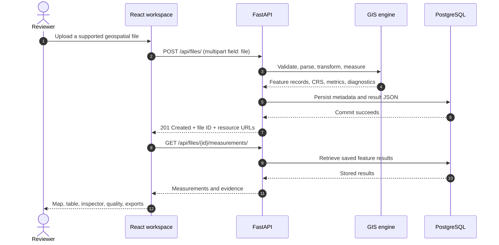

---

## How geospatial measurements work

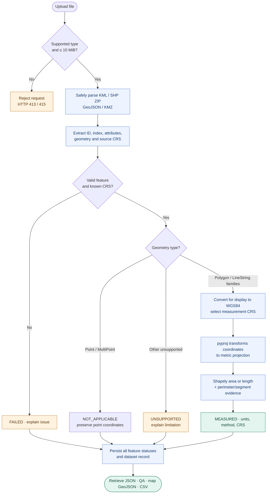

1. **Validate the uploaded dataset.** Check file type, nonempty content and the **10 MiB** upload limit. Archive handling additionally rejects unsafe paths and enforces limits on expanded size and file counts.
2. **Extract source evidence.** Parse KML Placemarks, required Shapefile components (`.shp`, `.shx`, `.dbf`, optional `.prj`), GeoJSON Features or KMZ KML. Preserve per-feature index, ID, type, attributes and original CRS.
3. **Validate per feature.** Unreadable/invalid geometry, missing Shapefile CRS, coordinate and transformation errors become `FAILED` records with diagnostic detail. Points remain inspectable without invented area/length.
4. **Choose a metric CRS.** Use WGS84 for browser geometry and a suitable projected CRS for each measurable feature; retain both CRS labels in the result.
5. **Calculate and attach evidence.** Use planar projected geometry for area/length, plus polygon perimeter/centroid or line-part/segment details. Preserve warnings, method and measurement units.
6. **Persist and expose results.** Store metadata and structured results; retrieve them by the generated file ID, download CSV/GeoJSON or supply IDs to later spatial analyses.

An HTTP **201 Created** means the upload was accepted and persisted; it does **not** mean every feature was measurable. A dataset may be `COMPLETED_WITH_ERRORS`. Always check individual statuses.

### Geometry decision table

| Geometry | Metric result | Status |
| --- | --- | --- |
| `Polygon`, `MultiPolygon` | Area **m²**, perimeter evidence **m** | `MEASURED` if valid |
| `LineString`, `MultiLineString` | Length **m**, segment evidence | `MEASURED` if valid |
| `Point`, `MultiPoint` | Location retained; no area/length | `NOT_APPLICABLE` |
| Other unsupported geometry | No fabricated measurement; reason retained | `UNSUPPORTED` |
| Invalid geometry / missing CRS / bad transform | Diagnostic and error evidence | `FAILED` |

### Why CRS selection matters

**EPSG:4326 longitude/latitude coordinates are angular degrees, not metres.** Computing Shapely `.area` or `.length` on unprojected degrees does not answer an area/length-in-metres question.

| Situation | Implemented measurement rule |
| --- | --- |
| Local geometry within supported UTM latitude/extent bounds | Pick UTM zone from location (`EPSG:326xx` north / `EPSG:327xx` south) |
| Large/polar polygon | Locally centred Lambert azimuthal equal-area (LAEA), with a caveat |
| Large/polar line | Locally centred azimuthal equidistant (AEQD), with a caveat |
| Missing/unknown source CRS (for example, Shapefile without usable `.prj`) | Fail the measurement rather than guessing coordinates |
| Display geometry and overlays | WGS84 coordinates for web-map interoperability |

The implemented method is **2D projected planar geometry**, not a geodesic/terrain or survey-certification engine. Projection distortion, bad source coordinates and elevations can still affect real-world accuracy.

### Worked example — a known-size square

For reproducibility, the displayed verification run used a synthetic **100 m × 100 m** polygon in a zipped Shapefile. In the screenshot, its **source and measurement CRS are both EPSG:32643** (UTM zone 43N). This is **one test case, not a required file or a fixed result for other uploads**. The verified measurement is:

| Field | Result |
| --- | ---: |
| Projected polygon area | **10,000 m²** |
| Projected polygon perimeter | **400 m** |
| Source CRS | `EPSG:32643` (projected UTM 43N) |
| Selected metric CRS | `EPSG:32643` (UTM zone 43N) |
| Status | `MEASURED` |
| Method | `projected_planar_geometry` |

**The result is accompanied by the source feature, CRS labels, unit, WGS84 bounds, polygon-part count and centroid evidence**, rather than only a standalone number. Values are from synthetic fixtures and are not a claim of certified field accuracy.

---

## Spatial intelligence beyond the assignment

These tools reuse *stored dataset IDs*. They do not calculate results from hard-coded React values.

| Analysis | Operation | Output and verified example |
| --- | --- | --- |
| **Survey quality** | Classify measured, not applicable and failed features; explain issues | Demo fixture: **3 features** → 1 measured, 1 Point not applicable, 1 failed |
| **Survey comparison** | Union baseline/current polygons; compute intersections/differences in a common local metric CRS | Shifted-square fixture: ~**5,000 m²** each added, removed and overlapping; ~**33.33% IoU** |
| **Parcel topology** | Compare parcel polygons pairwise; optionally compare survey union against an independent reference boundary | Fixture: **1 overlap**, ~**5,000 m²** |
| **Routes & zones** | Intersect route geometry with the union of zone polygons to avoid double-counting | Fixture: **140 m** route → **40 m inside**, **100 m outside** |

### Spatial overlay logic

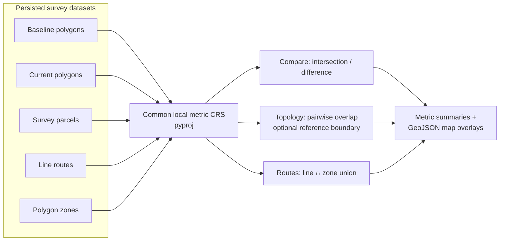

**Important topology distinction:** an overlap can be calculated from the submitted parcels alone. An *uncovered area* or *outside-reference area* can only be assessed when a separate reference boundary is supplied. GeoInsight does not mistake a missing reference for “zero gaps.” Large/complex studies have additional feature, geometry and geographic-extent limits.

---

## API reference — the required contract first

**Base URL:** [`https://geoinsight-aereo.onrender.com`](https://geoinsight-aereo.onrender.com)

**Interactive OpenAPI:** **[Try requests in Swagger →](https://geoinsight-aereo.onrender.com/docs)**

### Required by Aereo

| Method | Endpoint | Response |
| --- | --- | --- |
| **`POST`** | **`/api/files/`** | `201` — process `multipart/form-data` field `file`; return file ID, metadata and resource URLs |
| **`GET`** | **`/api/files/{id}/`** | Stored file metadata: name, source CRS, hash, counts, status |
| **`GET`** | **`/api/files/{id}/measurements/`** | All feature records: geometry, CRS, attributes, metric measurement, warnings and evidence |

### Additional endpoints

| Method | Path | Purpose |
| --- | --- | --- |
| `GET` | `/api/files/{id}/quality/` | Feature-level QA and dataset diagnostics |
| `GET` | `/api/files/{id}/summary/` | Aggregate results and geometry counts |
| `GET` | `/api/files/{id}/geojson/` | WGS84 GeoJSON for inspection/maps |
| `GET` | `/api/files/{id}/export/?format=csv` | Download CSV; supports `format=geojson` |
| `POST` | `/api/analysis/compare` | `{ "baseline_file_id": "…", "current_file_id": "…" }` |
| `POST` | `/api/analysis/topology` | `{ "file_id": "…", "reference_file_id": "…" }` (reference optional) |
| `POST` | `/api/analysis/route-zones` | `{ "route_file_id": "…", "zone_file_id": "…" }` |
| `GET` | `/health` | Database-aware readiness check |
| `GET` | `/docs` | Swagger UI |

### Copy, run, inspect (PowerShell)

Use a **local file of your choice** (`.kml`, `.zip` containing an ESRI Shapefile, `.geojson`, or `.kmz`). The following commands prompt for its full path, upload it to the public assessment API, then retrieve the actual results. **Do not upload confidential or personal survey data.**

```powershell
$base = "https://geoinsight-aereo.onrender.com"
$filePath = (Read-Host "Full path to your KML, zipped Shapefile, GeoJSON or KMZ file").Trim('"')
if (-not (Test-Path -LiteralPath $filePath -PathType Leaf)) { throw "File not found: $filePath" }

# Upload the file you selected; .kml and zipped Shapefile are the required formats.
$response = curl.exe -fsS -F "file=@$filePath" "$base/api/files/" | ConvertFrom-Json
$id = $response.id
$response | Format-List id, filename, status, feature_count, successful_measurements

# Retrieve the two mandatory GET resources.
Invoke-RestMethod "$base/api/files/$id/" | Format-List
$results = Invoke-RestMethod "$base/api/files/$id/measurements/"
$results.measurements | Select-Object id, geometry_type, crs, measurement_crs, status, measurement
```

Use the same steps for **any supported upload type**. The returned file ID and measurements depend on your input; the API generates a new ID for each upload.

<details>
<summary><strong>Example response shape (illustrative, abbreviated)</strong></summary>

```json
{
  "file_id": "<generated-32-character-id>",
  "filename": "survey.geojson",
  "crs": "EPSG:4326",
  "feature_count": 1,
  "status": "COMPLETED",
  "measurements": [
    {
      "id": "example-square",
      "index": 0,
      "geometry_type": "Polygon",
      "crs": "EPSG:4326",
      "measurement_crs": "EPSG:32643",
      "status": "MEASURED",
      "measurement_method": "projected_planar_geometry",
      "measurement": { "type": "area", "value": 10000.0, "unit": "m2" },
      "evidence": { "perimeter_m": 400.0 }
    }
  ]
}
```

This is a deliberately simplified representation of `GET /api/files/{id}/measurements/`, **not** a verbatim live response. Full records also include source geometry, properties and issues.

</details>

### Export or analyse your saved data

```powershell
# Export a real server-generated CSV and GeoJSON file.
curl.exe -fLsS "$base/api/files/$id/export/?format=csv" -o "geoinsight-results.csv"
curl.exe -fLsS "$base/api/files/$id/export/?format=geojson" -o "geoinsight-results.geojson"

# Quality report and aggregate summary.
Invoke-RestMethod "$base/api/files/$id/quality/"
Invoke-RestMethod "$base/api/files/$id/summary/"
```

To compare **your own two compatible polygon surveys**, upload each file using the **Measure** or **Compare** interface (or `POST /api/files/`), then supply the two returned IDs:

```powershell
$body = @{ baseline_file_id = "<baseline-id>"; current_file_id = "<current-id>" } | ConvertTo-Json
Invoke-RestMethod -Method Post "$base/api/analysis/compare" -ContentType "application/json" -Body $body
```

**HTTP errors:** unsupported file extension `415`; oversized/empty upload `413`; invalid file/analysis `422`; missing ID `404`; storage/database problems `503`. An accepted file can still contain per-feature `FAILED` records; always review status and diagnostics.

---

## Technology and repository layout

| Layer | Technology | Role |
| --- | --- | --- |
| API | **Python 3.11 · FastAPI · Pydantic** | Uploads, contracts, OpenAPI, validation |
| GIS | **Shapely · pyproj · PyShp · safe XML/ZIP parsing** | Extract, transform and measure vector geometry |
| Data | **SQLAlchemy · PostgreSQL** (hosted), **SQLite** (local preview) | Persist feature results and metadata |
| UI | **React · Vite · React Router** | File upload, analysis workspaces and navigation |
| Maps | **Leaflet · React Leaflet** | Vector display, overlays and feature inspection |
| Release | **Docker · Uvicorn · Render** | One-origin deploy of static React assets and FastAPI |
| Verification | **pytest · Node tests · ESLint · Vite · GitHub Actions** | Regression, lint and production-build checks |

```text
Spatial-Asset-Management-Platform/
├── README.md                           ← this GeoInsight assessment guide
├── aereo/
│   ├── api.py                          ← REST APIs / SQLAlchemy persistence
│   ├── production.py                   ← one-origin React + FastAPI host
│   └── Dockerfile                      ← multi-stage production image
├── app/services/geospatial/
│   ├── engine.py                       ← parsing, CRS and measurements
│   ├── quality.py                      ← QA rules and diagnostics
│   ├── reporting.py                    ← summary, CSV and GeoJSON
│   └── spatial_intelligence.py         ← compare, topology, route/zone
├── frontend/src/pages/
│   ├── Geospatial/                     ← measurement workspace
│   ├── SpatialIntelligence/            ← QA, compare, topology, routes
│   └── GeoGuide/                       ← reviewer documentation
├── frontend/public/samples/           ← browser demo datasets
├── aereo_samples/                     ← synthetic GIS fixtures
├── aereo_tests/                       ← isolated backend/API tests
├── docs/
│   ├── GEOINSIGHT_TECHNICAL_GUIDE.md
│   └── SPATIAL_ASSET_MANAGEMENT_PLATFORM.md
├── aereo-requirements.txt
├── requirements.txt
└── .github/workflows/aereo-ci.yml
```

The GeoInsight implementation spans several folders in a repository that also has an older application; **`aereo/` alone is not a runnable standalone export**.

---

## Run locally

### Option A · Full app (recommended)

Docker builds the real React frontend and the Python API together. Run these from a clean clone:

```powershell
git clone https://github.com/dhanushgowdars/Spatial-Asset-Management-Platform.git
cd Spatial-Asset-Management-Platform

docker build -f aereo/Dockerfile -t geoinsight:release .
docker run --rm --name geoinsight-preview -p 18140:8000 `
  -v geoinsight-results:/data geoinsight:release
```

Open **[http://localhost:18140/geospatial](http://localhost:18140/geospatial)** for the app, `http://localhost:18140/docs` for Swagger, and `http://localhost:18140/health` for database-aware health. The local preview uses SQLite at `/data/measurements.sqlite3` in the **named Docker volume**. Stopping the container does not erase the volume.

### Option B · Python API only

```powershell
python -m venv .venv
.\.venv\Scripts\Activate.ps1
python -m pip install -r requirements.txt -r aereo-requirements.txt
uvicorn aereo.api:app --host 127.0.0.1 --port 18130
```

Swagger is at `http://127.0.0.1:18130/docs`. Without `AEREO_DATABASE_URL`, the API uses local SQLite under `.aereo/`. Use the Docker method to reproduce the public frontend/API integration.

### Deployed environment

| Item | Live configuration |
| --- | --- |
| Deployment URL | **[GeoInsight /geospatial](https://geoinsight-aereo.onrender.com/geospatial)** |
| Build | `aereo/Dockerfile`, build context `.` |
| Runtime | FastAPI factory `aereo.production:create_production_app`, Uvicorn port **8000** |
| Hosting | Render free web service; React and API on one HTTPS origin |
| Persistence | Render PostgreSQL, connected by private `AEREO_DATABASE_URL` environment variable |
| Health | [`/health`](https://geoinsight-aereo.onrender.com/health) checks database availability |

**No credentials or database connection strings are included in this repository guide.** Do not upload private/customer survey datasets to the unauthenticated public demo. Render free services can spin down, and the free database has short-lived retention; this is an assessment deployment, not permanent storage.

---

## Testing and reproducibility

The implementation was verified with **synthetic known-size geometry** and API/CI checks. In particular, the live public GeoJSON upload returned `COMPLETED`, one measured feature, **10,000 m² area** and **400 m perimeter** via export. The stored ID remained available after a web-service restart.

| Check | Recorded verification |
| --- | --- |
| Isolated Aereo backend suite | **81 / 81 passed** |
| Frontend logic/presentation tests | **14 / 14 passed** in reported local run |
| Real local HTTP acceptance suite | **37 / 37 passed** |
| Frontend lint and production build | Passed |
| Public reviewer routes | **7 / 7** checked routes returned HTTP 200 |
| Cloud health | `{"status":"healthy"}` |
| Cloud data persistence | Uploaded record retrievable after service restart |
| GitHub Actions | **Both API regression and React lint/build jobs passed** on `1bba33f` for the [feature branch](https://github.com/dhanushgowdars/Spatial-Asset-Management-Platform/actions/runs/38122862336) **and** [main](https://github.com/dhanushgowdars/Spatial-Asset-Management-Platform/actions/runs/38123212462) |

The visible regression evidence is **test evidence**, not certified land-survey precision, security audit or load test. The current CI runs isolated Aereo backend tests plus a frontend contract test, lint and build; the larger local frontend tests are not all part of the CI workflow.

Run the isolated checks:

```powershell
python -m pytest aereo_tests -q
node --test frontend/src/pages/SpatialIntelligence/demoContracts.test.mjs `
  frontend/src/pages/SpatialIntelligence/derivedProvenance.test.mjs `
  frontend/src/pages/SpatialIntelligence/presentation.test.mjs
npm --prefix frontend ci
npm --prefix frontend run lint
npm --prefix frontend run build
```

> [!CAUTION]
> The repository's *older* `tests/conftest.py` can drop/recreate tables in its configured **test** database. Do not run indiscriminate legacy tests or database migrations without proving isolation. The Aereo assessment suite is explicitly in [`aereo_tests/`](aereo_tests/).

### What is tested

- Required KML and zipped-Shapefile parsing; optional GeoJSON/KMZ; multipart geometries and attributes.
- Valid projected area/length, polygon perimeter and centroid, line evidence, Point non-applicability, malformed data and unknown CRS.
- Archive-safety checks, bounded inputs, per-feature QA and partial-failure reporting.
- CSV/GeoJSON outputs, persisted API contracts, overlay comparisons, topology reference semantics and route/zone length conservation.
- Production SPA deep links and CI frontend lint/build compatibility.

For verification methodology and automated coverage, see the **[Aereo regression tests](aereo_tests/)**. Synthetic fixtures in the repository support reproducibility; they are optional and not required to operate the API.

---

## Decisions, safeguards and limitations

| Design decision | Why it matters |
| --- | --- |
| **Keep the required FastAPI API independent** | Delivers the exact assignment contract without activating the older authentication/PostGIS application |
| **Project before measuring** | Avoids interpreting geographic degrees as metres; exposes the selected CRS and planar method |
| **Return per-feature evidence and status** | Helps reviewers distinguish measurable, inapplicable and failed geometry instead of hiding bad input |
| **Use deterministic geometry overlays** | Survey comparison, topology and route-zone analysis are explainable Shapely calculations |
| **Use persisted IDs and one-origin hosting** | Frontend and API analyse the same saved records; PostgreSQL survives a web-service restart |
| **Bound uploaded data** | 10 MiB upload limit, archive checks and geometry/feature limits help contain malformed inputs |

**Boundaries of this release:**

- The **public** API has **no authentication, per-user isolation or rate limiting**. Use public/synthetic datasets only; knowing a stored ID enables retrieval. Uploaded-result retention and deletion are not managed for end users.
- Limits include 10 MiB compressed uploads, up to 5,000 features per upload and tighter limits for complex overlays. Inputs exceeding those boundaries can be rejected.
- Metrics are **2D projected planar** results; not certified cadastral, geodesic over continental extents, elevation-aware, raster/DEM or photogrammetric reconstructions.
- The free Render deployment may cold-start and its free PostgreSQL offering is temporary (30-day lifetime in the configured assessment plan). It should not be treated as long-lived production hosting.

### What I learned / next steps

This assignment exercises **file-format interoperability, coordinate reference system handling, geometric validation, REST contract design, failure semantics, persistent evidence, deterministic spatial analysis and reviewer-first UI design**.

Possible follow-ups—**not claimed as implemented**—include authentication and user-scoped files, retention/deletion controls, background processing for large surveys, async job status, certified geodesic/field benchmarking, database backups and a separate standalone GeoInsight repository after the assessment.

---

## Repository scope and project separation

**This README is exclusively about the Aereo GeoInsight assessment.** This Git repository was originally created for a separate **Spatial Asset Management Platform** with asset CRUD, JWT/RBAC, PostGIS queries, audit logs and location history. Its original documentation has been preserved intact at **[docs/SPATIAL_ASSET_MANAGEMENT_PLATFORM.md](docs/SPATIAL_ASSET_MANAGEMENT_PLATFORM.md)**.

The original platform's APIs are **not** part of the public GeoInsight deployment, and its unfinished frontend is **not** presented as a completed feature here. Splitting the two applications into independent repositories is future cleanup, not a requirement for this submission.

**Further technical context:** [GeoInsight supporting guide](docs/GEOINSIGHT_TECHNICAL_GUIDE.md) · [API implementation](aereo/api.py) · [GIS engine](app/services/geospatial/engine.py) · [Regression tests](aereo_tests/) · [CI workflow](.github/workflows/aereo-ci.yml)

---

<div align="center">

### Explore the working application

**[Open GeoInsight →](https://geoinsight-aereo.onrender.com/geospatial)** · **[Try Swagger →](https://geoinsight-aereo.onrender.com/docs)** · **[Follow the reviewer guide →](https://geoinsight-aereo.onrender.com/geospatial/guide)**

<sub>GeoInsight · Aereo Geospatial File Measurement API assessment · October 2026</sub>

</div>
