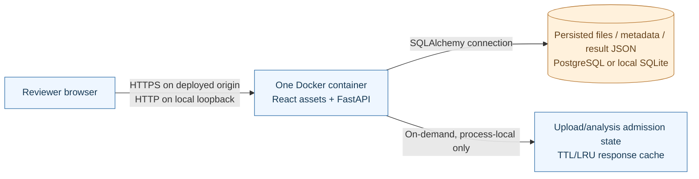
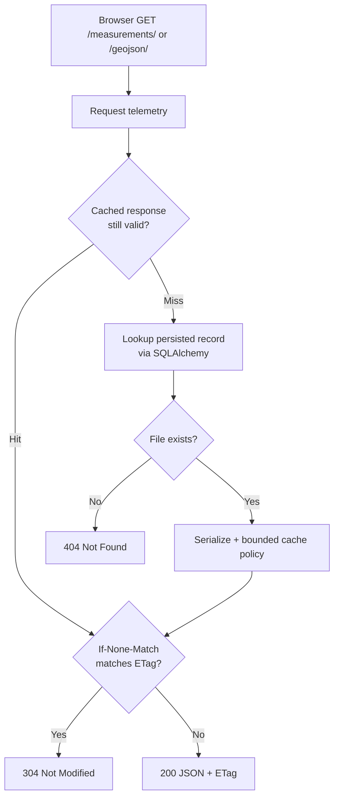
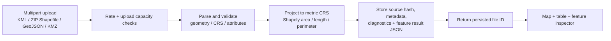
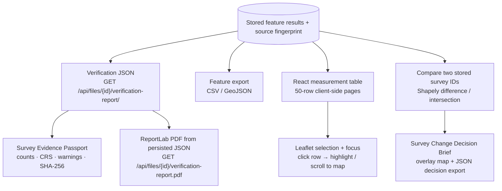

# GeoInsight V2 — Architecture and Data Flows

> **Scope and deployment status (October 2026):** This document describes the **locally verified V2 release candidate**, not a feature-complete deployment at the existing public Render URL. It complements the [main README](../README.md) and [local verification record](GEOINSIGHT_V2_VERIFICATION.md). The original submitted application and this V2 sandbox share a deployment pattern; V2 is not published until the controlled release.

## 1. System boundary and technology roles

GeoInsight packages a compiled **React + Leaflet** frontend and **FastAPI** backend in one multistage Docker image (`aereo/Dockerfile`). `aereo/production.py` serves static assets and API routes on a single origin. Core geospatial processing is Python **Shapely + pyproj**; persistent records are handled by **SQLAlchemy** with local SQLite or PostgreSQL (validated in a separate Docker test). PostgreSQL does **not** perform PostGIS geospatial calculations for GeoInsight.

- The current *public* service is the **earlier submission**; don't describe locally tested V2 caching, reports or timing as already deployed.
- Authentication, user-specific access isolation, permanent file retention and cluster-wide quotas are **not implemented**. Only upload **public or synthetic** data.
- The older **Spatial Asset Management Platform** is a distinct codebase within the same repository. Its RBAC / PostGIS / asset management endpoints are **not** part of this application.

## 2. Request and processing layers (phases 2–5)

| Logical layer | V2 implementation | Scope / limitations |
| --- | --- | --- |
| Request metadata | ASGI request telemetry adds server-generated `X-Request-ID`, `Server-Timing`, and JSON-shaped request logs (method, route template, status, duration) | No distributed trace collector or external telemetry service; `Server-Timing` reflects time to response headers |
| Upload rate | In-memory, per-peer limiter for `POST /api/files/`, default **120 per 60 seconds**; HTTP **429** with `Retry-After` | Process-local; not authenticated per-user quotas; bounded peer-state memory |
| Upload capacity | Admission semaphore, default **4** active uploads; overload returns **503** with `Retry-After` | Rejects excess concurrent work rather than queueing without bounds |
| Threaded persistence | Blocking upload transaction commit/refresh runs off the asynchronous event loop, with correct session ownership | Reduces event-loop blocking; it is **not** a background job queue or guaranteed latency improvement |
| Analysis capacity | Concurrent compare / topology / route-zone operations bounded (default **4**); **503** overload | Process-local, not a distributed queue |
| Read cache | `/measurements/` and `/geojson/` responses: LRU/TTL default **32 entries / 32 MiB total / 4 MiB item / 60s**; `ETag`, `If-None-Match`, `304` | In-process memory; misses hit DB; does not cache upload/post/verification endpoints; persisted immutable IDs retain normal 404 behavior |

The cache and rate limiter are logical capabilities **inside FastAPI**, not separately deployed proxies, Redis services or additional databases. Their counters and cached values do not survive application restarts. Separate replicas would have separate state.

The local warm-cache p95 figures in [the verification record](GEOINSIGHT_V2_VERIFICATION.md) came from short runs and are **illustrative**, not audited production SLOs.

## 3. Persisted measurement lifecycle (phases 1–2)

Records contain an uploaded-byte **SHA-256**, processing status, counts, source CRS, feature measurements, warnings and feature properties. An **unmeasurable Point** is not assigned a fictitious area/length. Polygon area totals represent **arithmetic sums**, not necessarily nonoverlapping unions. Surface/slope calculations, cadastral certification and geodesic guarantees are out of scope.

## 4. Evidence, exports and the browser experience (phases 6–7)

- **JSON verification report:** derived from previously persisted measurements; provenance includes the originally uploaded file hash, CRS, status and warnings; it does **not** replay or independently check the input.
- **PDF:** a printable **bounded feature appendix**, stored data and limitations. ReportLab creates a PDF download; it does not create a signed/certified survey. In Phase 7C the appendix was updated to show `m²` and stored polygon perimeter.
- **Frontend pagination:** React paginates an already downloaded measurements array in pages of **50**, so this is **not API pagination** or a reduced payload size.
- **Change brief:** baseline/current synthetic polygons each measure 10,000 m², while added, removed and unchanged regions each measure 5,000 m². Net area is zero but footprints differ; intersection/union is **33.33%**. All derived areas come from deterministic geometry operations, not AI prediction.
- The map renders geospatial results using WGS84 for display, while measurements use appropriate metric projected CRS; those two coordinate contexts must not be confused.

## 5. Build, runtime and verification boundaries

| Environment | Database | What has been verified |
| --- | --- | --- |
| Windows V2 worktree | Separate test SQLite databases | **160 backend tests** and **4 PDF formatting checks**, plus frontend lint/build and targeted interaction tests |
| Linux production Docker image (isolated local run) | Disposable SQLite | `/health`, frontend routes and OpenAPI return 200; zipped-Shapefile upload and PDF download succeeded |
| Linux production Docker image (isolated local run) | PostgreSQL 16 (separate Docker container) | Health, stored feature/result retrieval, verification JSON and PDF; the same record survived an **application container restart** |
| Public Render deployment | Hosted PostgreSQL (previous submitted version) | Public V2 features are **not yet deployed**; the old public app is deliberately left unchanged during V2 verification |

The tested Docker image preceded the final PDF **display** polish. Rebuild and smoke-test that final image before publication. The short synthetic benchmark timings and local HTTP checks are documented with caveats in [the verification record](GEOINSIGHT_V2_VERIFICATION.md). This is not an end-to-end security audit, stress-test certification, distributed-systems benchmark, or database backup/restore test.

## 6. Engineering decisions still pending for V2 release

1. Verify the final Docker image built after the PDF polish; compare container health, upload, report and public frontend assets.
2. Review empty root `LICENSE` and decide whether to add a recognized license; don't change legal terms without intention.
3. Finalize `CHANGELOG.md`, release notes and a dedicated release verification checklist.
4. Stage **only approved source, tests, benchmark code and documentation**. Exclude `.runtime/`, `phase*/`, generated benchmark outputs, local `.aereo/` databases, venv, and temporary images/patch archives.
5. Push and deploy only after confirming branch/commit, CI and the absence of secrets. Validate the real Render URL after deployment.

This document is an **architecture description**, not an assertion that every security, performance or hosting requirement has been solved.
